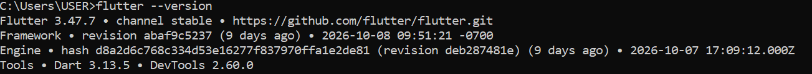
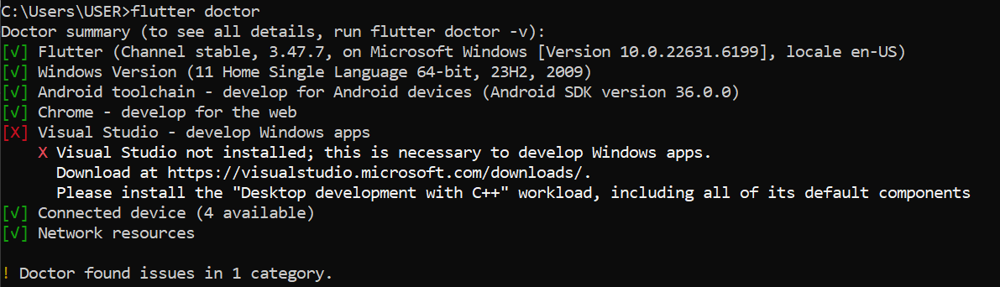
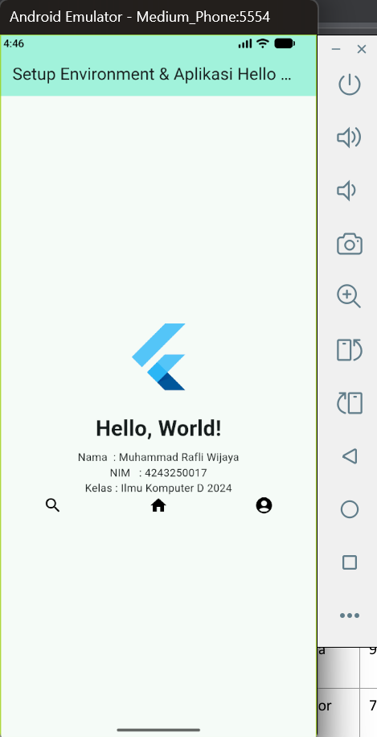

A. Identitas: 
- Nama: Muhammad Rafli Wijaya
- NIM: 4243250017
- Kelas: PSIK 24D

B. Keluaran Flutter:

C. Flutter Doctor:

D. Aplikasi Berjalan:

E. Dua Kendala yang Dialami:
1. Kendala menjalankan emulator pada android studio, ketika di start muncul pop-up box berisi "The emulator process for AVD... has terminated". Ternyata masalah penyimpanan, emulator storage internal di set default 10GB, sedangkan penyimpan C: tersisa 7GB, jadi SOLUSI-nya saya pindahkan avd emualator ke D: dengan agar bisa start emulator dengan internal 8GB.
2. Kendala saat melakuakn flutter run, running gagal/failed, di terminal tertulis:
Package ndk not found.
Package 28.2.13676358 not found.
Jadi saya tanya AI kenapa begini, ternyata NDK versi 28.2.13676358 belum terpasang, jadi saya install lagi ke android studi mengikuti tutorial dari AI tersebut. Setelah terpasang, flutter berhasil berjalan dan template counter flutter tampil di emulator.

F. Pernyataan Penggunaan AI:
Secara jujur saya hanya menggunakan AI untuk membantu setup dan menyelesaikan masalah yang saya sebutkan pada poin 'E', selain itu juga saya menggunakan AI bagaiman menambahkan widget, posisi peletakan dan di umpakan dengan programming pada web biar lebih mudah di pahami. Widget yang saya tambahkan sendiri saya ambil dari dokumentasi resmi yaitu flutter.dev
link: https://api.flutter.dev/flutter/widgets/Icon-class.html?_gl=1*1q0zpnl*_gcl_au*MTIzNjIxODAwNy4xNzkyMDQ0NDA0*_ga*NDA4MTg0NTIzLjE3OTIwNDQ0MDM.*_ga_04YGWK0175*czE3OTIyMjg4ODEkbzUkZzEkdDE3OTIyMzEwNzkkajU3JGwwJGgw
.. dengan menggunakan google font untuk nama iconnya: https://fonts.google.com/icons
Selebihnya saya mengikuti panduan dari pdf.

G. ESAI SINGKAT:
Pengembangan aplikasi mobile punya tiga pendekatan yang umum digunakan, yaitu ada Native, Hybrid, dan Cross-platform. Ketiganya memiliki perbedaan dalam teknologi, proses pengembangan, serta hasil aplikasi yang dibuat.

Native adalah pendekatan untuk membuat aplikasi khusus pada satu sistem operasi dengan menggunakan teknologi resminya, seperti Kotlin untuk Android dan Swift untuk iOS. Pendekatan ini memberikan performa yang baik serta akses maksimal ke fitur perangkat. Namun, jika aplikasi harus tersedia di Android dan iOS, developer biasanya perlu membuat dan memelihara dua basis kode. Contoh kasus yang tepat adalah aplikasi game dengan grafis berat atau aplikasi yang membutuhkan akses perangkat secara intensif.

Hybrid menggunakan teknologi web seperti HTML, CSS, dan JavaScript yang dijalankan dalam sebuah WebView agar dapat digunakan sebagai aplikasi mobile. Cara ini memungkinkan pengembang memanfaatkan keterampilan web dan menggunakan kembali sebagian besar kode. Namun, performa dan pengalaman pengguna dapat terbatas untuk fitur yang kompleks. Contoh yang sesuai adalah aplikasi katalog produk sederhana untuk bisnis kecil. 

Cross-platform memungkinkan pengembangan aplikasi untuk beberapa sistem operasi menggunakan satu basis kode dengan framework seperti Flutter atau React Native. CAra ini dapat menghemat waktu pengembangan dan memprmudah pemeliharaan, meskipun beberapa fitur tetap butuh penyesuaian khusus platform. Contohnya adalah aplikasi pemesanan makanan yang tersedia untuk pengguna Android dan iOS.